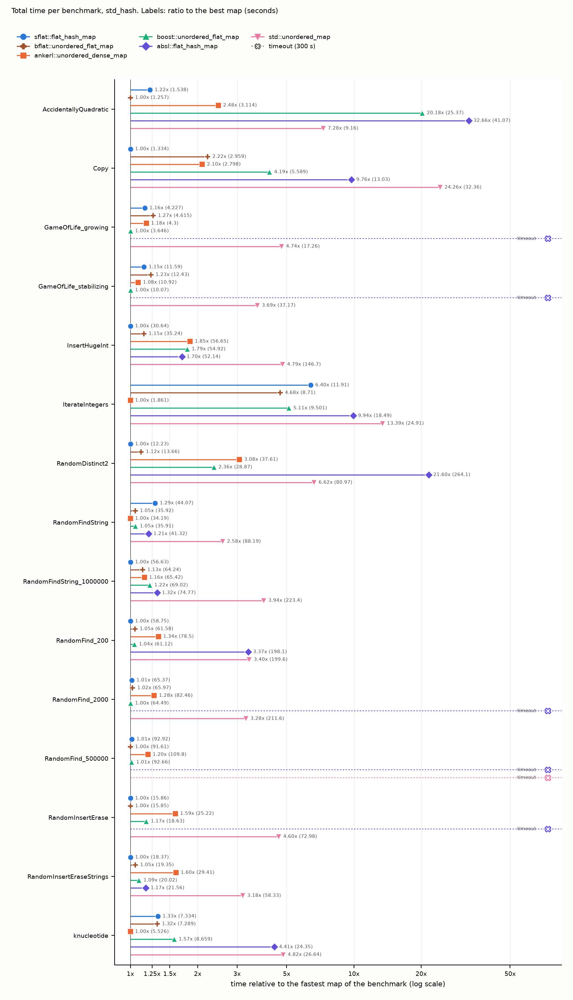
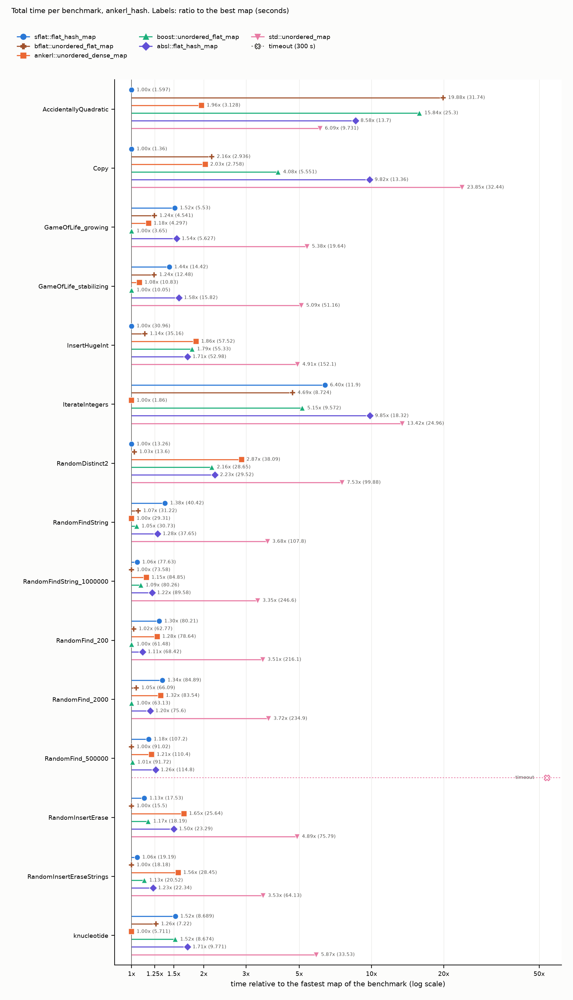

# map_benchmark subset on an i5-3230M (2026-11-14)

sflat::flat_hash_map, bflat::unordered_flat_map, ankerl::unordered_dense_map, boost::unordered_flat_map, absl::flat_hash_map and std::unordered_map, each
with `std_hash` and `ankerl_hash`, on the original registered benchmarks (except the constructor/destructor and ShowHash ones).

**Read this first**

- **One iteration** of each benchmark (upstream runs 10), so a gap of a few percent is not significant.
- A run that took longer than **300 s** was killed and is shown as a timeout (exit 124 in `progress.log`).
- The harness is the tree of 610a6ab (before #2 and #3; the benchmark bodies in `src/benchmarks` are the same, #2 added the
  `FlatMap64` case, the RSS/VmPeak recording and changes in `src/app/bench.h` and `main.cpp`, whose effect on the timing was not checked), built with sflat at a0ac82a (main, with the performance changes of
  jclin168/sflat_hash_map#30). It is **not** the harness of the 2026-11-10 snapshot next to this directory, and the two sets of
  numbers are not comparable.
- bflat::unordered_flat_map (jclin168/bflat_hash_map, main 4aa8c39, see below) was added **a day later** with the same harness (610a6ab), machine and settings
  (`progress_bflat.log`, effective clock 1.27 to 1.37), and **both bflat and sflat were run again a day after that** on the
  versions named here (`progress_rerun.log`; effective clock 1.34 to 1.38, except one first reading of 1.096 before
  sflat's `GameOfLife_stabilizing` with `ankerl_hash` and one of 1.239 before bflat's `RandomFind_200` with `std_hash`).
  The numbers of bflat and sflat in this directory are from that rerun. The other four maps were
  not rerun. The first bflat run (ed5b7e6, with the review fixes) differs from the rerun in `AccidentallyQuadratic` and
  `IterateIntegers`, see below; sflat was at the same version (a0ac82a) in both runs and the numbers differ by up to 3%.
- "Peak MB" is the memory the benchmark itself reports for the whole process, including temporaries and allocator retention.
- Machine: Intel Core i5-3230M (Ivy Bridge, SSE4.2/AVX, no AVX2, 3 MB L3), 14 GiB, Ubuntu 26.04, GCC 15.2 `-O3 -march=native`,
  Boost 1.92 headers, absl 20260817.0. Both cores on the `performance` governor, turbo off (effective clock 1.34 to 1.36 before
  each run, `progress.log`), pinned to core 2, one run at a time.

## Total time

Relative to the fastest map of each benchmark (log axis). Labels: ratio to the best map and, in brackets, the seconds. Dashed line ending in an open X = timeout.

## Peak memory

Relative to the smallest map of each benchmark. The five benchmarks that use less than 3 MB (GameOfLife, IterateIntegers,
RandomFind_200 and _2000) are left out: there the memory is mostly the runtime. A timed-out run has no comparable peak and is
drawn as a dashed line with an open X.

The numbers behind the figures are in [summary.md](summary.md); `raw/` has the output of every run.

## What the numbers show

- **Inserting and copying many integers:** sflat is the fastest in InsertHugeInt (30.6 s against 54.9 s for boost and 56.7 s
  for ankerl with `std_hash`; 31.0, 55.3, 57.5 with `ankerl_hash`), RandomDistinct2 (12.2 s against 28.9 s for boost), Copy
  (1.3 s against 2.8 s for ankerl) and AccidentallyQuadratic (1.5 s against 3.1 s for ankerl), and the smallest in memory in
  the first three (InsertHugeInt 1266 MB against 1633 MB for boost, 1729 MB for ankerl and absl, 3791 MB for std).
- **RandomInsertErase:** sflat 15.9 s, boost 18.6 s, ankerl 25.2 s with `std_hash` (17.5, 18.2, 25.6 with `ankerl_hash`), but with
  more memory than ankerl (289 MB against 235 MB; boost 385 MB).
- **Lookups:** with `std_hash` sflat and boost are level on RandomFind (58.8 and 61.1 s at 200 elements; within 2% of each
  other at 2,000 and 500,000). With `ankerl_hash` boost is ahead: 61.5, 63.1 and 91.7 s against 80.2, 84.9 and 107.2 s for sflat
  (1.17x to 1.35x). On GameOfLife boost is ahead with both hashes (3.6 s and 10.1 s against 4.2 s and 11.6 s for sflat with
  `std_hash`; 3.6 s and 10.0 s against 5.5 s and 14.4 s with `ankerl_hash`).
- **Strings:** ankerl is the fastest on RandomFindString (34.2 s against 44.1 s for sflat with `std_hash`) and
  knucleotide (5.5 s against 7.3 s); sflat is the fastest on RandomFindString_1000000 with `std_hash` (56.6 s against 65.4 s for
  ankerl) and on RandomInsertEraseStrings (18.4 s, boost 20.0 s). On string benchmarks sflat uses 1.02x to 1.4x of the smallest
  memory; `std::unordered_map` is the smallest in RandomFindString_1000000, RandomInsertEraseStrings and knucleotide.
- **Iteration:** IterateIntegers takes 11.9 s in sflat and 1.9 s in ankerl (dense array); boost takes 9.5 s.
- **absl with `std_hash`:** it times out on GameOfLife (both), RandomFind_2000, RandomFind_500000 and RandomInsertErase and is
  slow on RandomDistinct2 (264 s). `std_hash` is the identity function for integers, which it does not handle well; with
  `ankerl_hash` it finishes all of them. `std::unordered_map` times out on RandomFind_500000 with both hashes.

To run again: build with `cmake -DMAPS="sflat_flat_hash_map|ankerl_unordered_dense|abseil_flat_hash_map|boost_unordered_flat_map|std_unordered_map" -DHASHES="std_hash|ankerl_hash" -DBOOST_INCLUDE_DIR=<boost headers> ..`
in `build-run`, compile `tools/clk.cpp` to `docs/results/2026-11-14-i5-3230M-subset/clk`, run `tools/run_subset.sh`, then
`tools/summarize_subset.py RAW PROGRESS > summary.md` and `tools/plot_subset.py RAW PROGRESS OUT_DIR`.

## bflat::unordered_flat_map

bflat is a Boost-`unordered_flat_map`-style table (15-slot groups with an overflow byte, SIMD group scan) that uses sflat's growth
(non power-of-two group counts, tiered growth, mmap and incremental migration). A review of it before this run found and fixed:
an exception from the hash or the move constructor during an incremental migration (duplicate elements, an endless loop with
`NDEBUG`), copy assignment freeing the old storage with the wrong allocator, `noexcept` on lookups that call the user's hash,
a range `insert` that shrank the table, and an inconsistent `max_size()`. All tests, also with ASan/UBSan, pass and the fixes do
not change the speed (within 1.5%). The numbers above are from the fixed version.

bflat 4aa8c39 adds two changes of bflat_hash_map#4 and #5 to the reviewed version: an iterator without a division per element
(a per-element cost of 9.5 ns instead of 1.8 ns), and a **reseed**: a table whose keys pile up at the start (an insert probes
64 groups) is rebuilt with a different hash multiplier. A hash declared avalanching (`ankerl_hash`) is used unmixed and keeps
the pile-up unless bflat is built with `-DBFLAT_RESEED_AVALANCHING=1`; this run uses the default (off). Effect on this run
(seconds, `std_hash`): AccidentallyQuadratic 32.1 to 1.3, IterateIntegers 28.1 to 8.7; the other benchmarks differ by 3% or
less. With `ankerl_hash` AccidentallyQuadratic is unchanged (31.7 s), IterateIntegers is 28.1 to 8.7 s.

From the numbers (`std_hash` unless said otherwise):

- bflat is second to sflat in InsertHugeInt (35.2 s against 30.6 s, boost 54.9 s) and RandomDistinct2 (13.7 s against 12.2 s,
  boost 28.9 s), level with sflat in RandomInsertErase (15.9 s each; boost 18.6 s) and the fastest in RandomFind_500000 (91.6 s against
  92.7 s for boost and 92.9 s for sflat).
- On the lookup benchmarks it is level with boost (61.6, 66.0 and 91.6 s against 61.1, 64.5 and 92.7 s). With `ankerl_hash` it is
  also level with boost and 1.2 to 1.3 times faster than sflat on RandomFind_200 and _2000 (62.8 and 66.1 s against 80.2 and 84.9 s).
- It is the fastest in AccidentallyQuadratic with `std_hash` (1.3 s; sflat 1.5 s, ankerl 3.1 s, boost 25.4 s), but with `ankerl_hash`
  it takes 31.7 s (reseed off for avalanching hashes; sflat 1.6 s, boost 25.3 s). It is 8.7 s in IterateIntegers (sflat 11.9 s,
  boost 9.5 s, ankerl 1.9 s), and slower than sflat in Copy (3.0 s against 1.3 s), and Copy and
  InsertHugeInt use more memory (131 MB against 75 MB, 1490 MB against 1266 MB for sflat). The reason for the memory was not investigated.
- Peak memory is mixed: bflat is the smallest in AccidentallyQuadratic (283 MB with `std_hash`, 273 MB with `ankerl_hash`; sflat 309 MB) and below sflat in RandomInsertErase
  (270 MB against 289 MB), and above it in RandomFind_500000 (22.3 MB against 20.7 MB) and RandomInsertEraseStrings
  (77.5 MB against 73.3 MB).
