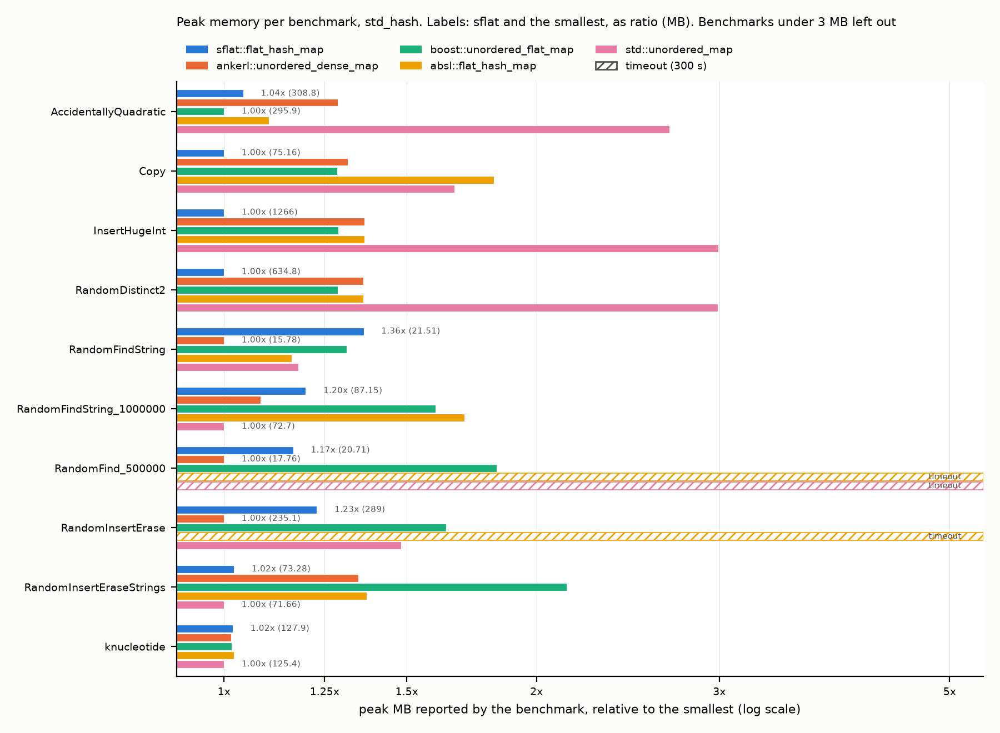
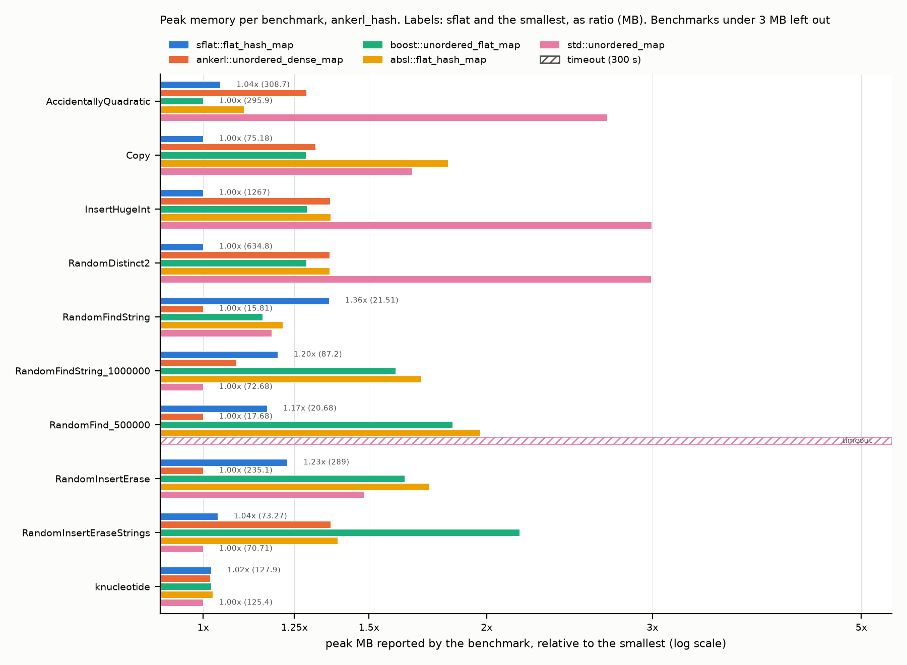

# map_benchmark subset on an i5-3230M (2026-11-14)

sflat::flat_hash_map, ankerl::unordered_dense_map, boost::unordered_flat_map, absl::flat_hash_map and std::unordered_map, each
with `std_hash` and `ankerl_hash`, on the original registered benchmarks (except the constructor/destructor and ShowHash ones).

**Read this first**

- **One iteration** of each benchmark (upstream runs 10), so a gap of a few percent is not significant.
- A run that took longer than **300 s** was killed and is shown as a timeout (exit 124 in `progress.log`).
- The harness is the tree of 610a6ab (before #2 and #3; the benchmark bodies in `src/benchmarks` are the same, #2 added the
  `FlatMap64` case, the RSS/VmPeak recording and changes in `src/app/bench.h` and `main.cpp`, whose effect on the timing was not checked), built with sflat at a0ac82a (main, with the performance changes of
  jclin168/sflat_hash_map#30). It is **not** the harness of the 2026-11-10 snapshot next to this directory, and the two sets of
  numbers are not comparable.
- "Peak MB" is the memory the benchmark itself reports for the whole process, including temporaries and allocator retention.
- Machine: Intel Core i5-3230M (Ivy Bridge, SSE4.2/AVX, no AVX2, 3 MB L3), 14 GiB, Ubuntu 26.04, GCC 15.2 `-O3 -march=native`,
  Boost 1.92 headers, absl 20260817.0. Both cores on the `performance` governor, turbo off (effective clock 1.34 to 1.36 before
  each run, `progress.log`), pinned to core 2, one run at a time.

## Total time

Relative to the fastest map of each benchmark (log axis). Labels: sflat and the best map, as ratio (seconds). Hatched = timeout.

## Peak memory

Relative to the smallest map of each benchmark. The five benchmarks that use less than 3 MB (GameOfLife, IterateIntegers,
RandomFind_200 and _2000) are left out: there the memory is mostly the runtime. A timed-out run has no comparable peak and is
hatched.

The numbers behind the figures are in [summary.md](summary.md); `raw/` has the output of every run.

## What the numbers show

- **Inserting and copying many integers:** sflat is the fastest in InsertHugeInt (30.4 s against 54.9 s for boost and 56.7 s
  for ankerl with `std_hash`; 30.7, 55.3, 57.5 with `ankerl_hash`), RandomDistinct2 (12.3 s against 28.9 s for boost), Copy
  (1.4 s against 2.8 s for ankerl) and AccidentallyQuadratic (1.5 s against 3.1 s for ankerl), and the smallest in memory in
  the first three (InsertHugeInt 1266 MB against 1633 MB for boost, 1729 MB for ankerl and absl, 3791 MB for std).
- **RandomInsertErase:** sflat 16.0 s, boost 18.6 s, ankerl 25.2 s with `std_hash` (17.5, 18.2, 25.6 with `ankerl_hash`), but with
  more memory than ankerl (289 MB against 235 MB; boost 385 MB).
- **Lookups:** with `std_hash` sflat and boost are level on RandomFind (59.2 and 61.1 s at 200 elements; within 2% of each
  other at 2,000 and 500,000). With `ankerl_hash` boost is ahead: 61.5, 63.1 and 91.7 s against 80.3, 85.1 and 107.7 s for sflat
  (1.17x to 1.35x). On GameOfLife boost is ahead with both hashes (3.65 s and 10.1 s against 4.11 s and 11.4 s for sflat with
  `std_hash`; 3.6 s and 10.0 s against 5.6 s and 14.5 s with `ankerl_hash`).
- **Strings:** ankerl is the fastest on RandomFindString (34.2 s against 44.5 s for sflat with `std_hash`) and
  knucleotide (5.5 s against 8.6 s); sflat is the fastest on RandomFindString_1000000 with `std_hash` (57.6 s against 65.4 s for
  ankerl) and on RandomInsertEraseStrings (18.9 s, boost 20.0 s). On string benchmarks sflat uses 1.02x to 1.4x of the smallest
  memory; `std::unordered_map` is the smallest in RandomFindString_1000000, RandomInsertEraseStrings and knucleotide.
- **Iteration:** IterateIntegers takes 12.0 s in sflat and 1.9 s in ankerl (dense array); boost takes 9.5 s.
- **absl with `std_hash`:** it times out on GameOfLife (both), RandomFind_2000, RandomFind_500000 and RandomInsertErase and is
  slow on RandomDistinct2 (264 s). `std_hash` is the identity function for integers, which it does not handle well; with
  `ankerl_hash` it finishes all of them. `std::unordered_map` times out on RandomFind_500000 with both hashes.

To run again: build with `cmake -DMAPS="sflat_flat_hash_map|ankerl_unordered_dense|abseil_flat_hash_map|boost_unordered_flat_map|std_unordered_map" -DHASHES="std_hash|ankerl_hash" -DBOOST_INCLUDE_DIR=<boost headers> ..`
in `build-run`, compile `tools/clk.cpp` to `docs/results/2026-11-14-i5-3230M-subset/clk`, run `tools/run_subset.sh`, then
`tools/summarize_subset.py RAW PROGRESS > summary.md` and `tools/plot_subset.py RAW PROGRESS OUT_DIR`.
